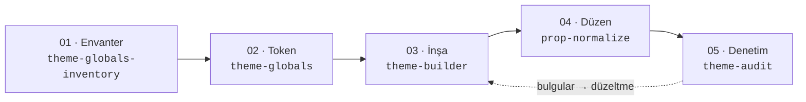

# ikas-cc-skills

ikas Code Components projelerinde kullanılmak üzere hazırlanmış Claude Code skill kütüphanesi.
Skill'ler tek bir plugin (`ikas-code-components`) altında toplanır ve Claude Code'un plugin
marketplace özelliğiyle dağıtılır.

**Uyumluluk:** `@ikas/component-cli` / `@ikas/code-components-mcp` / `@ikas/bp-storefront`
**2.9.2** ile doğrulandı.

## Kurulum

```
/plugin marketplace add ikascom/ikas-cc-skills
/plugin install ikas-code-components@ikas-cc-skills
```

Kurulumdan sonra skill'ler otomatik olarak kullanılabilir olur; Claude ilgili bir görevle
karşılaştığında skill'i kendisi devreye alır, `/ikas-theme-audit` gibi komutla elle de
çağrılabilir.

Güncelleme için:

```
/plugin marketplace update ikas-cc-skills
```

## Birlikte çalışırlar

Beş skill, bir temanın yaşam döngüsünü sırayla takip eder. Önce tasarım dili çıkarılır ve
token'a dönüştürülür, sonra tema bu token'larla inşa edilir. Ardından editör yüzeyi
düzenlenir ve en sonda tema denetlenir. Denetimin bulguları tekrar inşaya döner.



| # | Aşama | Skill | Ne yapar | Değişiklik yapar mı? |
|---|---|---|---|---|
| 01 | Envanter | [ikas-theme-globals-inventory](#envanter) | Temanın renk/tipografi kullanımını çıkarır, onaya hazır token katalog önerisi döndürür | Hayır (salt-okunur) |
| 02 | Token | [ikas-theme-globals](#token) | Onaylı katalogu tema global'i olarak kurar, CSS/TSX'i ve editör değerlerini token'lara bağlar | Evet: mağaza token'ları + kod |
| 03 | İnşa | [ikas-theme-builder](#insa) | Section/sub-component inşa eder, sayfa kompoze eder, hazır sayfaları kurar, denetim bulgularını düzeltir | Evet: kod + editör |
| 04 | Düzen | [ikas-prop-normalize](#duzen) | Tüm component'lerin prop/grup yapısını kanonik şemaya ve Türkçe etiketlere oturtur | Evet: yalnızca `ikas.config.json` (`audit` argümanıyla salt-okunur) |
| 05 | Denetim | [ikas-theme-audit](#denetim) | Temanın alışveriş deneyimini kural setine göre denetler, dayanaklı bulgu raporu döner | Hayır (salt-okunur) |

**Sıra bir öneridir, zorunluluk değildir.** Her skill tek başına çalışır:

- **Mevcut CSS'i olan tema:** 01 → 02 migration modunda ilerler.
- **Sıfırdan tema:** 01 atlanır, 02 kurulum modunda tasarım spec'inden başlar.
- **Tek bir section eklemek:** doğrudan 03 kullanılır.
- **Yayın öncesi:** 05 tek başına çalıştırılabilir.

**Döngü:** 05'in raporundaki her bulgu kural setinde bir bölüme (§) dayanır. 03'ün "audit
bulgularını düzelt" iş akışı bu raporu girdi olarak alır. Düzeltmenin ardından kapsamı
daraltılmış bir denetim çalıştırılır (`section <Name>` veya `surface <name>`) ve döngü
böyle kapanır.

---

<a id="envanter"></a>

### 01 · Envanter — ikas-theme-globals-inventory

`ikas-theme-globals`'ın **karar öncesi, salt-okunur yarısı.** Temanın gerçek CSS/TSX
kullanımından token envanterini çıkarır ve onaylanmaya hazır bir katalog önerisi döndürür.
Hiçbir token oluşturmaz, değiştirmez, silmez. İzole bir subagent'ta (`context: fork`)
çalışır.

**Tetikleyiciler:** token envanteri çıkar, design system dokümanı çıkar, hangi renkler
kullanılmış, token katalog önerisi, hardcoded renk taraması.

**Nasıl çalışır:**

`ikas-theme-globals`'ın 1-3. adımlarını izole bir subagent'ta koşturan ince bir
sarmalayıcıdır. Katalog kurallarını ve `inventory.py`'yi kopyalamaz, kardeş skill'den
okur; böylece kurallar tek yerde kalır. Döndürdüğü rapor şunları içerir:
- mimari önerisi (scheme ya da flat)
- renk ve tipografi katalog tabloları (varsayılan metin stili dahil)
- kapsam dışı bırakılanlar
- WCAG AA kontrast uyarıları

Rapor onaylanırsa uygulama `ikas-theme-globals` Adım 4'ten devam eder.

```
skills/ikas-theme-globals-inventory/
└── SKILL.md          # akış + rapor sözleşmesi (kurallar ikas-theme-globals'ta)
```

---

<a id="token"></a>

### 02 · Token — ikas-theme-globals

Bir ikas Code Components temasında **global token setini** (renk, tipografi, color
scheme; gerekirse breakpoint/keyframe) kurar. CSS/TSX'i ve editör değerlerini bu
token'lara bağlar, sonra doğrular. İki modu var:

- **Migration modu:** mevcut CSS'ten envanter çıkarıp token'a taşır.
- **Kurulum modu:** sıfırdan tema için tasarım spec'inden ilerler.

Token seti temanın kendi CSS diline göre tasarlanır; hazır katalog şablonu dayatılmaz.

**Tetikleyiciler:** tema global renk/tipografi token'ları, color scheme / palet kurulumu,
`create_theme_global`, design token migration, cssVar/className bağlama, hardcoded renk
temizliği.

**Nasıl çalışır:**

1. **Ön koşul:** `ikas-component dev` çalışıyor ve editör bağlı olmalı. İlk iş
   `list_theme_globals`; eşleştirme her zaman `id` ile yapılır.
2. **Envanter:** migration modunda `scripts/inventory.py` ile çıkarılır. Bu adım 01'e
   devredilebilir.
3. **Token seti tasarımı:**
   - Önce mimari kararı verilir: color scheme (slot + palet) ya da flat renk.
   - Sonra temaya özgü katalog önerisi hazırlanır.
   - Katalog, **kullanıcı onayı alınmadan oluşturulmaz**.
4. **Oluşturma ve güncelleme:** `create_theme_global` kullanılır. Her kind'ın yerinde
   güncelleme aracı vardır: `update_theme_color`, `update_text_style` (`is_default` ile
   varsayılan metin stili), `update_theme_breakpoint`, `update_theme_keyframe`,
   `update_theme_color_scheme`. Delete+recreate yasaktır.
5. **Bağlama:**
   - **Kod:** CSS/TSX'te `cssVar` / `className`, media query'de `bp(<id>)`.
   - **Editör değerleri:** COLOR prop'ları `patternValueId` ile token'a bağlanır.
   - **Hazır sayfalar:** login/hesap sayfalarının shared scope renkleri de token'a bağlanır.
6. **Doğrulama:** `scripts/verify.py` ile yapılır, `build` temiz geçmeli ve editörde canlı
   token testi yapılır. Script dört şeyi raporlar: dangling `var()`, kalan hardcoded
   renkler, TSX class-katalog eşleşmesi ve `@media` hataları (koşulda `var()`, bilinmeyen
   `bp()`, px dışı calc).

**Değişmezler:**

- Onaysız `create_theme_global` çağrısı yapılmaz.
- Token eşleştirme name ile değil `id` ile yapılır.
- cssVar asla elle türetilmez.
- Var olan token silinip yeniden açılmaz.

```
skills/ikas-theme-globals/
├── SKILL.md               # iş akışı, tuzak tabloları, bağlama kuralları
└── scripts/
    ├── inventory.py       # hardcoded renk/tipografi envanteri (frekans sıralı; var() fallback'leri ayrı)
    └── verify.py          # dangling var() + hardcoded kalıntı + class eşleşme + @media/bp() raporu
```

---

<a id="insa"></a>

### 03 · İnşa — ikas-theme-builder

Bir ikas storefront temasında **section ve sub-component inşa etme** iş akışı. Kapsamı:

- Yeni section scaffold etme, prop ekleme/çıkarma.
- Sayfa kompoze etme ve canlı editörde içerik doldurma.
- Hazır (ready-made) login/hesap sayfalarını kurma.
- Chrome surface kurma (drawer, modal, toast).
- Section review ve audit bulgularını düzeltme.

**Tetikleyiciler:** "add a new section", "create the X section", "add a prop", "compose
the homepage / PDP / cart page", "add login / my account pages", "add a drawer / modal /
toast", "review this section against the ruleset", "fix the audit findings".

**Dört bilgi kaynağı ve sahiplik alanları:**

| Kaynak | Neyin sahibi |
|---|---|
| `references/commerce.md` (skill ile gelir) | UX & dönüşüm kural seti: her yüzeyin ne YAPMASI gerektiği, editör sidebar şeması dahil |
| Design source (Figma/Stitch/design.md/kullanıcı) | Görsel her şey: layout, renk, tipografi, motion |
| Proje `CLAUDE.md` | Framework kuralları, CLI komut şekilleri, otomatik üretilen dosyalar |
| `ikas-code-components` MCP | Canlı framework kataloğu: template'ler, prop tipleri, fonksiyon dokümanları |

**Temel disiplinler:**

- Kod yazmadan önce ilgili commerce.md bölümü okunur.
- Framework gerçekleri hafızadan değil, MCP'den sorgulanır.
- **Görsel karar asla uydurulmaz:** design source'ta yoksa tasarım otoritesine sorulur.
- MCP yanıtlarındaki framework gerçekleri (must) ile referans tema alışkanlıkları
  (preference) ayrıştırılır.

**İş akışları:**

| | İş akışı | Özet |
|---|---|---|
| A | Yeni section | §13 katalog → §5 kontrat → design input → ENUM → MCP template → CLI scaffold → implement → pre-flight |
| B | Prop ekleme | §6 prop mimarisi, §1 prop felsefesi, CLI `add-prop` |
| C | Sayfa kompozisyonu | `get_editor_workflow` → batch araçlar. Header/footer değerleri INDEX'te durur; token bağlama; `move_page_section`; yıkıcı araçlar için onay |
| D | Chrome surface | MCP sub-component kataloğu, §9 yüzey kontratı, focus trap/Esc |
| E | Section review | §15 checklist, §14 anti-pattern'ler, `check` + `build` |
| F | Auth & hesap sayfaları | **Önce hazır sayfaları öner** (`list_ready_made_pages` → onay → `enable_ready_made_pages` → markalama). Özel section yalnızca kullanıcı isterse |
| G | Audit bulgularını düzelt | İhlal → Boşluk sırasıyla ilerlenir. Her bulgu ilgili iş akışına yönlendirilir, ardından kapsamı daraltılmış bir denetim yapılır |

**Bitiş kontrolü:** commerce.md §15 build checklist, design fidelity, `scripts/lint.py`
(§14'ün mekanik olarak yakalanabilen maddeleri, exit kodlu), `npx ikas-component check --json`
ve `build` temiz geçmeli.

```
skills/ikas-theme-builder/
├── SKILL.md                    # görev iş akışları (A-G), bitiş kontrolü
├── scripts/lint.py             # §14 lint'i: observer, backgroundColor, catch'siz sepet
│                               #   mutasyonu, sabit metin, reduced-motion, elle fiyat, çoklu h1
└── references/commerce.md      # tasarımdan bağımsız e-ticaret kural seti (~1000 satır;
                                #   audit ve prop-normalize de bu dosyayı okur)
```

---

<a id="duzen"></a>

### 04 · Düzen — ikas-prop-normalize

Bir ikas Code Components projesindeki **tüm** component'lerin prop/grup yapısını tek
geçişte tutarlı hale getirir: kanonik gruplama, Türkçe görünen adlar ve yalnızca gerekli
yerde editör açıklaması. Hedef, mağaza sahibinin editör sidebar'da gördüğü her etiketin
Türkçe, öngörülebilir sırada ve kendini açıklar durumda olmasıdır. İnşa sırasında biriken
prop'ları toparladığı için 03'ten sonra gelir.

**Tetikleyiciler:** prop gruplama, displayName Türkçeleştirme, `ikas.config.json` prop
düzeni, editör sidebar temizliği.

**Nasıl çalışır:**

1. **Envanter:** `scripts/audit.py` ile prop/grup dökümü çıkarılır ve kaynak dosyaların
   parmak izi alınır.
2. **Hedef şema:** commerce.md §6.3'teki editör sidebar şeması uygulanır. Builder da prop
   açarken aynı şemayı kullanır, yani 03 ile 04 aynı kurala göre çalışır. Şemanın özü:
   - Grup sırası: Veri → İçerik → (özellik grupları) → Ayarlar → Metinler → Renkler.
   - İçerik ile Metinler ayrımı: vitrin içeriği İçerik'e, arayüz metni Metinler'e gider.
   - Özellik grubu en az 3 prop olunca açılır.
   - Bütün renkler Renkler grubunda durur.
   - Etiketler Türkçedir; açıklama yalnızca 4 durumda yazılır.
3. **Uygulama:** her değişiklik `--component-id` ile CLI üzerinden yapılır
   (`update-prop`, `update-prop-group`, `move-prop-group`). Komutlar idempotent tek bir
   script'te toplanır.
4. **Doğrulama:**
   - audit.py yeniden çalıştırılır; bayraklar sıfırlanmalı.
   - Kaynak parmak izi değişmemeli (git gerekmez).
   - `check` ve `build` temiz geçmeli.

**Değişmezler:**

- Prop `name` ve grup `id` asla değişmez.
- `defaultValue` çevrilmez.
- `index.tsx` / `styles.css` dosyalarına dokunulmaz.

**Salt-okunur mod:** `/ikas-prop-normalize audit` planlanan değişiklikleri tablo olarak
döner ve hiçbir CLI komutu çalıştırmaz.

```
skills/ikas-prop-normalize/
├── SKILL.md          # iş akışı, kurallar, çeviri tablosu, sık hatalar
└── scripts/audit.py  # prop/grup envanteri + §6.3 yapı ve etiket bayrakları
```

---

<a id="denetim"></a>

### 05 · Denetim — ikas-theme-audit

Mevcut bir ikas temasının **alışveriş deneyimi denetimi**; kod incelemesi değildir. Ölçüt,
builder ile paylaşılan `commerce.md` kural setidir. Her bulgu ya ihlal ettiği bölümü
zikreder (§7.1, §13.B…) ya da açıkça "kontrat dışı" etiketlenir. Denetim **hiçbir şeyi
değiştirmez**; düzeltmeler `ikas-theme-builder`'a (iş akışı G) yönlendirilir.

**Tetikleyiciler:** "temayı denetle", "eksik section var mı", "akışlar doğru mu",
"pre-launch review", "bu tema yayına hazır mı".

**Bulgu sınıflandırması:**

| Sınıf | Anlamı |
|---|---|
| İhlal (blocker) | commerce.md kontratını kırar (ör. sessiz sepet hatası) |
| Boşluk (gap) | Zorunlu bir surface/chrome fonksiyonu tamamen yok: ne section ne de etkin bir hazır sayfa karşılıyor |
| Tema tercihi | Kural setinin izin verdiği tasarım sapması; engel değil |
| Kontrat dışı öneri | Faydalı olabilir ama hiçbir kural gerektirmiyor |

**Beş geçişli denetim prosedürü:**

1. **Surface envanteri:** kod + hazır sayfa durumu (`list_ready_made_pages`).
2. **Shopper journey yürüyüşü:** 7 aşama.
3. **Section bazında §13 zorunlu özellik kontrolü.**
4. **§14 anti-pattern taraması:** önce builder'ın `lint.py`'si, sonra kalan maddeler.
5. **Merchant gerçeklik kontrolü.**

Editör bağlı değilse, section'ı olmayan hesap/auth yüzeyleri yanlışlıkla "Boşluk" olarak
raporlanmaz; **Doğrulanamadı** bölümüne yazılır.

**Rapor sözleşmesi:** Rapor Türkçedir ve şu sırayı izler: karar cümlesi → ihlaller → boşluklar →
tema tercihleri → kontrat dışı öneriler (maks 5) → doğrulanamayanlar → öncelikli aksiyon
listesi. Kapsam argümanları: tam denetim, `surface <name>`, `section <Name>`, `quick`.

```
skills/ikas-theme-audit/
└── SKILL.md          # severity taksonomisi, 5 geçişli prosedür, rapor sözleşmesi
                      #   (ölçüt: ikas-theme-builder/references/commerce.md)
```

---

## Bakım

Kurallar tek yerde tutulur, skill'ler birbirine göreli yolla başvurur. Bu yüzden skill'ler
tek plugin olarak birlikte kurulmalıdır.

| Kaynak | Sahibi | Okuyanlar |
|---|---|---|
| `commerce.md` (davranış kuralları + editör sidebar şeması §6.3) | ikas-theme-builder | theme-audit, prop-normalize |
| `lint.py` (§14 mekanik kontroller) | ikas-theme-builder | theme-audit |
| Token katalog kuralları + `inventory.py` | ikas-theme-globals | theme-globals-inventory |

Framework gerçekleri (araç imzaları, değer şekilleri) skill'lere kopyalanmaz. Skill'ler
MCP'ye işaret eder, çünkü her ikas sürümünde bayatlayan kısım kopyalanan gerçeklerdir.

## Lisans

[MIT](LICENSE) © İKAS TEKNOLOJİ A.Ş.
